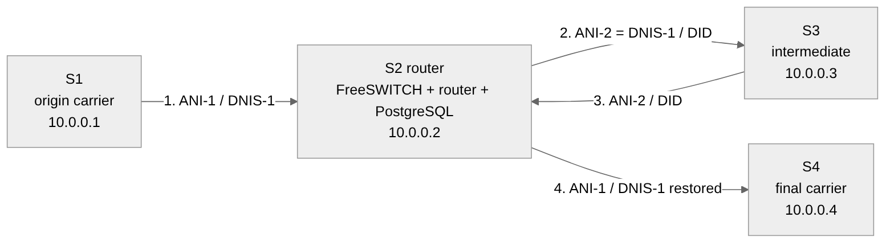
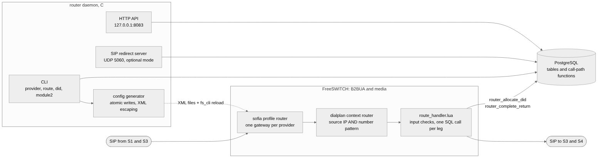
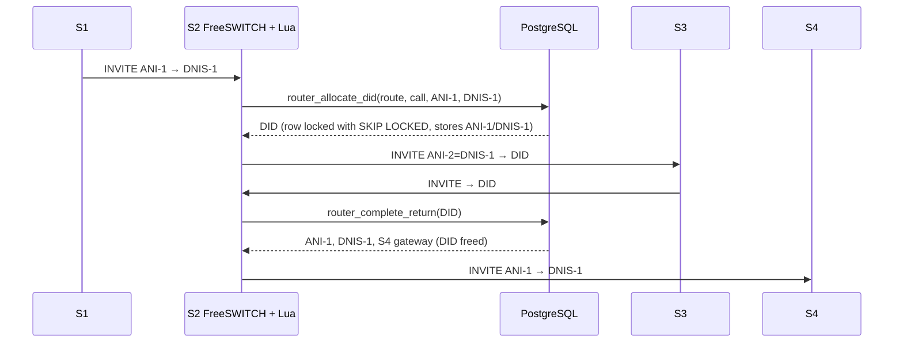

# FreeSWITCH call router: S1 → S2 → S3 → S2 → S4

A SIP call router for carriers and call centres. Calls arrive from an origin server (S1). The router (S2) sends each call through an intermediate server (S3) on a temporary number taken from a DID pool. When the call comes back on that DID, the router restores the original caller and destination and delivers it to the final carrier (S4).

The call path runs in **FreeSWITCH** with a small Lua handler. All state lives in **PostgreSQL**, behind four SQL functions that are safe under concurrency. A **C daemon and CLI** manage providers, routes and DIDs, generate the FreeSWITCH configuration, and can also act as a stateless SIP redirect server.



| Leg | From → To | Caller (ANI) | Destination (DNIS) |
|---|---|---|---|
| 1 | S1 → S2 | ANI-1 | DNIS-1 |
| 2 | S2 → S3 | ANI-2 = DNIS-1 | a free **DID** from the pool |
| 3 | S3 → S2 | ANI-2 | the same DID |
| 4 | S2 → S4 | ANI-1 (restored) | DNIS-1 (restored) |

The DID is the only link between legs 2 and 3. It must therefore never be shared by two calls, never stay stuck, and never accept a return call that was not issued. This project guarantees all three, and the tests prove it.

---

## What this version adds

This repository is an overhaul of the original code. [docs/AUDIT.md](docs/AUDIT.md) lists every defect found and how it was reproduced and fixed. In short:

| | Before | After |
|---|---|---|
| **DID allocation** | `SELECT … ORDER BY RANDOM()` then `UPDATE`: two round trips, a full sort, and a race | One SQL function using a partial index and `FOR UPDATE SKIP LOCKED` |
| Throughput (50,000 DIDs, 8 clients) | 213 calls/s, 37.6 ms | **2,293 calls/s, 3.5 ms (10.8×)** |
| DIDs handed to two calls at once | 16 of 400 | **0 of 400** |
| **SIP parsing** | Call-ID, From and To share one static buffer (all three end up equal); missing header → segfault | Allocation-free parser, RFC 3261 responses, fuzzed under ASan |
| **Security** | SQL injection from SIP headers (C and Lua), shell injection into `fs_cli`, password `router123` compiled in, `10.0.0.1` matched `10.0.0.10`, dialplan IP check bypassable (`break="never"`) | Bound parameters, strict input formats, no shell, secrets from the environment, exact matching, ANDed dialplan conditions |
| **Concurrency** | Deadlocks (mutex re-locked), use-after-free on every 30 s reload | Snapshot-and-swap reload, lock discipline, atomics |
| **Repository** | 192 files: binaries, `.o`, `.bak`/`.rej`, 9 schemas, 6 Makefiles, broken CMake, 3 Lua handlers | 1 Makefile, 1 schema, 1 Lua handler |
| **Tests / CI** | none (`tests_disabled/`) | 5 suites, gcc + clang `-Werror`, ASan/UBSan, cppcheck, CodeQL |

---

## Architecture





There are more diagrams in [docs/ARCHITECTURE.md](docs/ARCHITECTURE.md): the full call sequence with failure paths, the database schema, the DID and call life cycles, configuration generation, and CI.

| Part | Where | Role |
|---|---|---|
| Call-path SQL | [`sql/002_functions.sql`](sql/002_functions.sql) | `router_allocate_did`, `router_complete_return`, `router_cancel_did`, `router_release_stale_dids`: each is one transaction |
| Schema | [`sql/001_schema.sql`](sql/001_schema.sql) | The single source of truth. Idempotent, never drops data |
| Lua handler | [`freeswitch/scripts/route_handler.lua`](freeswitch/scripts/route_handler.lua) | Validates input, makes one SQL call per leg, releases its DB handle before bridging |
| Config generator | [`src/freeswitch/fs_xml_generator.c`](src/freeswitch/fs_xml_generator.c) | Writes the `router` sofia profile, gateways, dialplan and `router_db_dsn`. Writes are atomic, values are escaped, stale files are pruned |
| SIP redirect server | [`src/sip/`](src/sip) | Optional stateless mode: answers 302 to the next hop and uses the same SQL functions |
| HTTP API | [`src/api/handlers.c`](src/api/handlers.c) | `GET /health`, `/api/v1/stats`, `/api/v1/route?number=`. Loopback only by default |
| CLI | [`src/commands/`](src/commands) | `provider`, `route`, `did`, `module2`, `validation`, `stats`, `freeswitch generate` |

---

## Quick start (laptop, no FreeSWITCH needed)

```bash
# Ubuntu 24.04 / Debian 12
sudo apt install build-essential pkg-config libpq-dev libjson-c-dev libmicrohttpd-dev \
                 uuid-dev libreadline-dev postgresql lua5.4 libxml2-utils

make                                              # -> ./router
ROUTER_DB_PASSWORD='choose-a-long-secret' tools/setup-db.sh --seed

export PGHOST=localhost PGDATABASE=router_db PGUSER=router PGPASSWORD='choose-a-long-secret'
./router route list
./router route test 12125550000                   # which route takes this number
./router module2 test 15550001111 12125550000     # dry run of both legs (rolled back)
```

```text
Route 1, dry run (nothing is kept):
  S1 -> S2   ANI-1 15550001111      DNIS-1 12125550000
  S2 -> S3   ANI-2 12125550000      DNIS-2 12125551001   (DID taken from the pool)
  S3 -> S2   calls back on DID 12125551001
  S2 -> S4   ANI   15550001111      DNIS   12125550000   (restored, DID freed, gateway a1b2…0004)
```

To run the daemon without FreeSWITCH (SIP redirect mode plus the HTTP API):

```bash
ROUTER_LOG_FILE=- ./router --daemon --no-freeswitch &
curl -s localhost:8083/health
curl -s 'localhost:8083/api/v1/route?number=12125550000'
```

To deploy with FreeSWITCH (profile, `vars.xml`, `mod_lua`, systemd), follow [docs/OPERATIONS.md](docs/OPERATIONS.md).

---

## Commands

```text
provider add <name> <host:port> <origin|intermediate|final> <capacity> ip:<addr> | user:<u>:<p>
provider list | show <name> | delete <name> | reload
route add <name> <origin> <intermediate> <final> '<pattern>' <priority>
route list | show <id|name> | delete <id|name> | reload | test <number>
did add <number> <country> [provider] | import <csv> [provider] | list | release <did>
module2 status | test <ani> <dnis> [route] | monitor | validate <did>
freeswitch generate [--no-reload]
stats | sip status | validation status|rules|events
```

Route patterns are regular expressions over digits, for example `1[2-9][0-9]{9}` or `212[5-7]\d{8}`. They are validated before they are stored or written into XML.

---

## Tests and CI

| Suite | What it proves | Run |
|---|---|---|
| Unit (C, ASan + UBSan) | SIP parser and input safety. 75 checks plus 20,000 fuzz rounds | `make test` |
| CLI + FreeSWITCH files | Every command works on a fresh DB, injection attempts change nothing, the generated XML is well-formed (`xmllint`) and the dialplan cannot be bypassed. 30 checks | `make test-db` |
| SQL concurrency | 40 simultaneous calls on 10 DIDs give 10 distinct DIDs. 20 simultaneous returns give exactly 1 winner. Stale sweep and ownership | `make test-db` |
| Lua handler | The real `route_handler.lua` runs against real SQL with a fake `session` and `freeswitch`. 10 scenarios | `make test-db` |
| SIP end-to-end | The daemon is built with ASan. S1/S3/S4 are UDP sockets on 127.0.0.1/.3/.4, sending real INVITEs, garbage datagrams and 35 parallel calls, and the test reloads data while the daemon runs. 24 checks | `make test-e2e` |
| Benchmark | Original allocation logic against the new one, run in CI and written to the job summary | `make bench` |

On every push, GitHub Actions ([`.github/workflows`](.github/workflows)) runs:
- builds with gcc and clang with `-Werror`;
- a hardening check (PIE, full RELRO, stack protector);
- cppcheck, shellcheck and `luac`;
- every suite above, against PostgreSQL 16;
- CodeQL `security-extended`.

Tags `v*` publish a tarball with its SHA-256.

The database suites rebuild `PGDATABASE`, so point it at a throwaway database.

---

## Repository layout

```text
src/            C sources: main, cli, commands, core (config, safety, HTTP server),
                db (PostgreSQL), freeswitch (config generator), router, sip, validation
include/        headers
sql/            001_schema.sql, 002_functions.sql, seed_demo.sql
freeswitch/     scripts/route_handler.lua (installed into FreeSWITCH's script dir)
tests/          unit/ cli/ sql/ lua/ e2e/ bench/
tools/          setup-db.sh, monitor.sh
scripts/        freeswitch-router.service (systemd, hardened)
docs/           ARCHITECTURE, OPERATIONS, AUDIT, guide-entretien, diagrams/ (Mermaid), img/,
                examples/freeswitch/ (configuration generated from the demo data)
```

## Known limits

- **Redirect mode keeps the caller ID.** A 302 cannot rewrite it, so ANI masking needs the FreeSWITCH (B2BUA) mode. The redirect server only tells callers where to go next.
- **One database connection serialises queries.** The C daemon uses a single connection behind a mutex. The FreeSWITCH call path does not use it: Lua uses FreeSWITCH's own pooled handles. A connection pool is the next step for the daemon.
- **The `validation` subsystem is incomplete.** It is kept from the original code and now fixed: no deadlock, no injection, no shell. But it relies on an `active_calls` feed that nothing populates yet.
- **The SIP server is IPv4/UDP only.** The HTTP API has no authentication and is therefore bound to 127.0.0.1.
