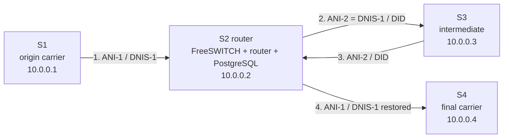
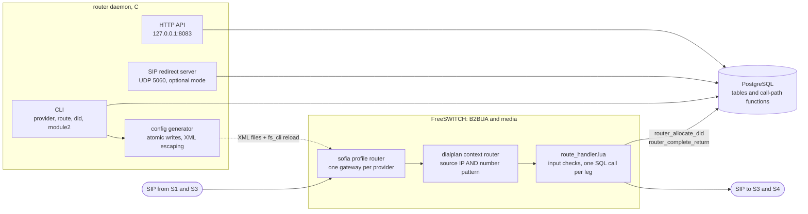
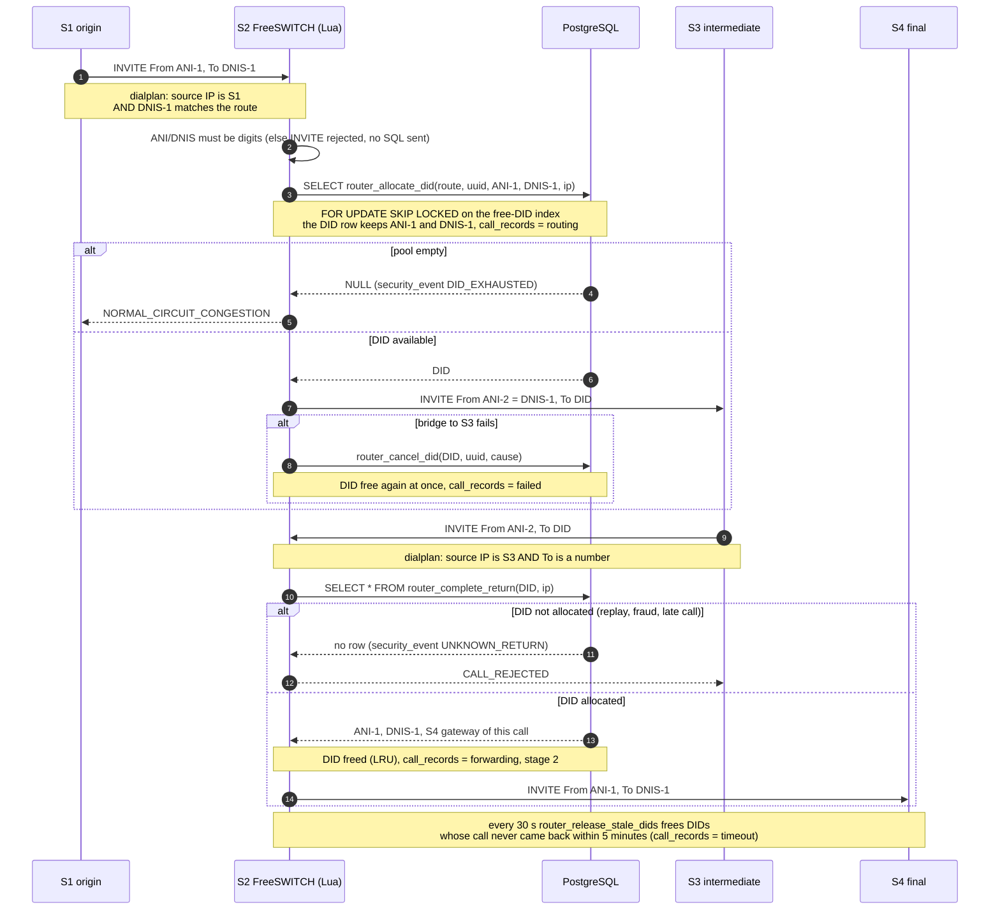
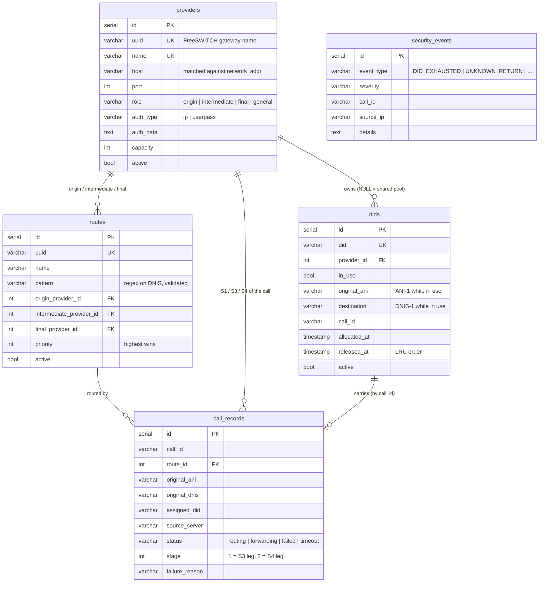
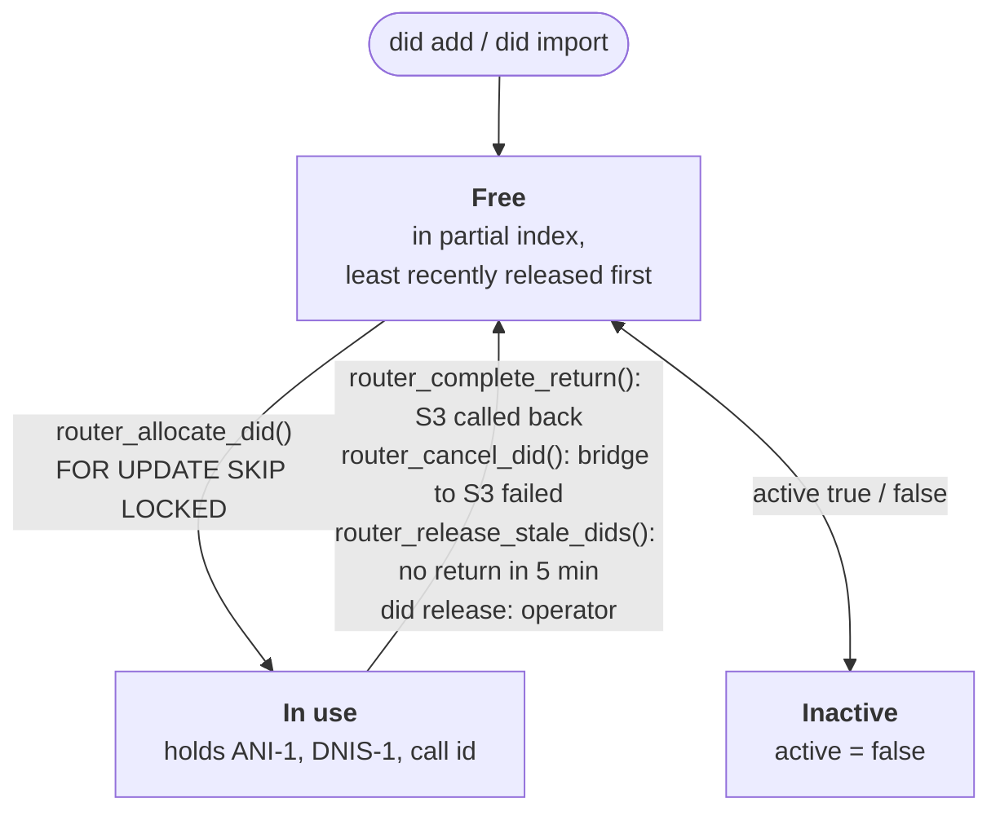
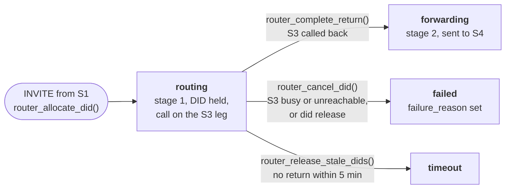
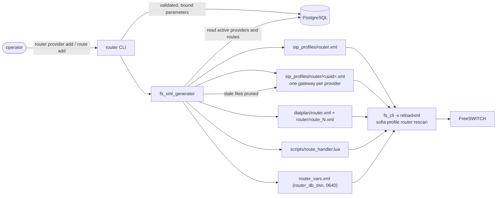
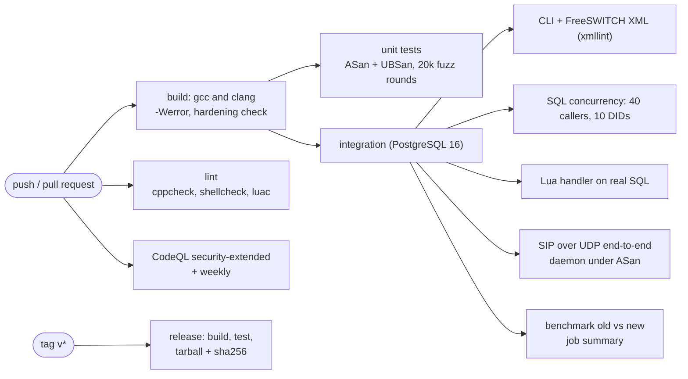

# Architecture

This page explains how a call crosses the router, where its state lives, and why the design holds under load and under attack. Each diagram below is also available as an image in [`img/`](img), and its Mermaid source is in [`diagrams/`](diagrams).

## 1. The four call legs



A call from S1 must reach S4 after passing through S3. S3 must never see the original destination, and S4 must see the original caller. S2 therefore sends the call to S3 on a temporary number (a DID) and keeps the mapping DID → (ANI-1, DNIS-1) until S3 calls back on that DID.

| Leg | Caller ID sent | Number dialled | Who decides |
|---|---|---|---|
| S1 → S2 | ANI-1 | DNIS-1 | S1 |
| S2 → S3 | **DNIS-1** (ANI-2) | **DID** | `route_handler.lua origin` + `router_allocate_did` |
| S3 → S2 | ANI-2 | DID | S3 |
| S2 → S4 | **ANI-1** | **DNIS-1** | `route_handler.lua intermediate_return` + `router_complete_return` |

## 2. Components on S2



- **FreeSWITCH** carries the media and acts as a B2BUA, which is the only place the caller ID can be rewritten. The router owns one sofia profile (`router`) and one dialplan context (`router`). It never edits FreeSWITCH's own files.
- **route_handler.lua** is deliberately thin:
  - it rejects anything that is not a phone number before any SQL is built;
  - it makes one SQL call per leg;
  - it releases its pooled DB handle **before** bridging. A bridge lasts as long as the call, and the original handler held a connection for the whole call.
- **PostgreSQL** holds every piece of state. The four call-path functions are the only code that changes DID ownership, so the Lua handler, the C redirect server and the CLI all behave the same way.
- **The router daemon** is the control plane (CLI, configuration generator, HTTP API). It can also serve as a stateless SIP redirect server for labs or setups without media.

## 3. Call sequence, including failures



Every failure is answered and recorded:

| Situation | Answer to the caller | Database effect |
|---|---|---|
| ANI or DNIS not a phone number | `INVITE` rejected (`INVALID_NUMBER_FORMAT` / SIP 484) | nothing. No SQL is sent |
| Source IP not a provider | not matched by the dialplan / SIP 403 | nothing |
| No route for DNIS-1 | 404 | nothing |
| DID pool empty | congestion / SIP 503 | `security_events: DID_EXHAUSTED` |
| S3 busy or unreachable | bridge failure | `router_cancel_did`: DID freed at once, call `failed` |
| Return on a DID that is not allocated (replay, late call, fraud) | `CALL_REJECTED` / SIP 403 | `security_events: UNKNOWN_RETURN` |
| S3 never calls back | none | `router_release_stale_dids` frees the DID after 5 min, call `timeout` |

## 4. Data model



`sql/001_schema.sql` is the only schema file. It is idempotent (`IF NOT EXISTS`, `ADD COLUMN IF NOT EXISTS`, `ON CONFLICT`), so upgrades are just a rerun. The original repository had nine schema files that disagreed with each other, and some tables were created by the binary at every start.

### Why allocation is fast and safe

```sql
SELECT * FROM dids
WHERE in_use = false AND active = true AND provider_id IS NULL
ORDER BY released_at NULLS FIRST, id
LIMIT 1
FOR UPDATE SKIP LOCKED;
```

- **Partial indexes** (`dids_free_shared_idx`, `dids_free_provider_idx`) contain only free DIDs, already in the order they should be handed out. The planner reads one index entry, whatever the pool size. The original `ORDER BY RANDOM()` sorted every free DID on every call.
- **Two indexes instead of one.** `provider_id = X` fixes the leading index column, so the rows come out already ordered. `provider_id IS NULL` does not, and would force a sort. The provider's own DIDs are tried first, then the shared pool.
- **`FOR UPDATE SKIP LOCKED`.** Concurrent calls lock different rows without waiting for each other. The original code read a DID, then updated it in a second statement. Between the two, another call could take the same DID: 16 of 400 calls in the benchmark.
- **Least recently released first.** A DID is not handed out again immediately, which leaves time for late or retransmitted return calls from its previous use to arrive and be rejected.

The benchmark is `tests/bench/did_alloc_bench.sh`: 50,000 DIDs, 8 clients, allocate + free.

| | calls/s | ms per call | DIDs held by two calls |
|---|---|---|---|
| original logic | 213 | 37.6 | 16 / 400 |
| `router_allocate_did` | **2,293** | **3.5** | **0 / 400** |

## 5. Life cycles

DID:



Call record (`call_records.status`):



## 6. Configuration generation



- Every file is written to `name.tmp` and then renamed, so FreeSWITCH never reads a half-written file.
- Every value that comes from the database is either validated (uuid, host, number pattern) or XML-escaped. A route pattern such as `1"/><x` is refused at `route add` and again at generation time.
- The two dialplan conditions of an extension (source IP and number) are ANDed. The original used `break="never"` on the IP condition, which let any source through.
- Gateways of deleted or deactivated providers are pruned on reload.
- Files that hold secrets (`router_vars.xml`, and gateways with a SIP password) are written with mode 0640.

[`examples/freeswitch/`](examples/freeswitch) contains exactly what the generator produces from `sql/seed_demo.sql`.

## 7. Concurrency inside the C daemon

| Shared data | Protection |
|---|---|
| Providers and routes in the SIP server | Arrays rebuilt from the database, then swapped under a mutex. Request handlers copy the entries they need while holding the lock, so a reload never frees memory a request is reading. The original freed linked lists that handlers were still using. |
| SIP / router counters | C11 atomics |
| Validation records | The caller holds the mutex for the whole time it uses a record. The hang-up helper takes no lock, so the validation thread can call it. The original re-locked a non-recursive mutex, which deadlocks. |
| Stop flags | `atomic_bool`. The threads sleep in short slices, so SIGTERM returns within about a second. |
| PostgreSQL connection | One connection behind a mutex. This is a known limit, see the README. |

## 8. Trust boundaries

| Input | From | Checks |
|---|---|---|
| SIP headers (Call-ID, From, To) | network, spoofable over UDP | Parsed into separate bounded buffers. The URI user part must be a number. Only bound SQL parameters are used |
| Caller ID / destination in Lua | network via FreeSWITCH | `^%+?%d+$`, at most 33 characters, quoted as well, and checked again by `router_is_number()` inside SQL |
| Call UUID passed to `fs_cli` | network | Token format checked, then passed as an argument to `posix_spawnp`, never through a shell |
| CLI arguments | operator | Names, hosts and patterns validated. SQL uses bound parameters |
| Database values written into XML | operator via the database | Validated or XML-escaped |
| HTTP API | local host | GET only, read-only, bound to 127.0.0.1 by default |

## 9. CI


